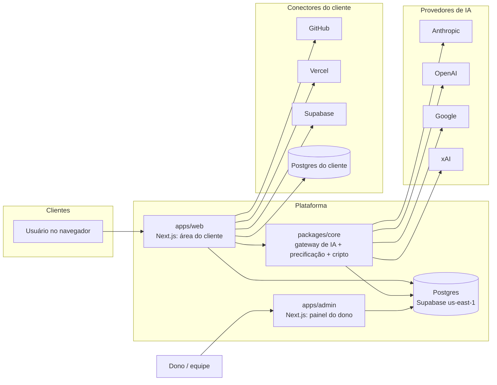

# 2. Arquitetura

## Visão geral



**Resposta à pergunta "o painel do dono deve ser outro ecossistema?"** Sim e não. Deve ser **outro app, com deploy,
domínio e login próprios** (ex.: `admin.forja.com.br`, com 2FA obrigatório e lista de IPs permitidos), porque uma falha no
app do cliente não pode abrir a porta para as chaves de API. Mas **não deve ter outro banco nem outra base de código**:
os dois apps leem o mesmo Postgres e usam o mesmo núcleo (`packages/core`, `packages/db`). Assim não existe
sincronização entre sistemas: o preço que você muda no painel vale na próxima chamada do cliente.

## O caminho de uma mensagem

```
1. Cliente envia mensagem         POST /api/chat (apps/web)
2. Autorização (antes de gravar)  modelo ativo? plano libera a faixa? saldo ≥ mínimo? há chave no pool?
3. Persistência                   conversa + mensagem do usuário
4. Gateway (packages/core)        escolhe a chave por prioridade, chama o provedor em streaming
                                  └─ falhou antes de responder? tenta a próxima chave do pool
5. Streaming                      texto vai para o navegador em NDJSON
6. Medição                        tokens: entrada, leitura de cache, escrita de cache, saída
7. Precificação                   custo US$ = Σ tokens × tabela do modelo (com sobretaxa de contexto longo)
                                  cobrança R$ = custo × câmbio × (1 + sobrecusto) × (1 + markup)
8. Uma transação no banco         usage_events + credit_ledger (débito) + saldo da organização
9. Resposta final                 custo da mensagem e saldo novo aparecem para o cliente
```

Regras que estão no código e cobertas por testes (`packages/core/test`):

- **Falha do provedor não é cobrada do cliente.** O custo parcial estimado fica registrado só para a sua conciliação.
- **Fallback da Anthropic**: em Fable 5.1, Opus 5.5 e Sonnet 5.5 o gateway liga o fallback no servidor. Se o
  classificador de segurança recusar, a API reexecuta num modelo alternativo, e cada tentativa é precificada pela tabela
  do modelo que de fato rodou (`usage.iterations`).
- **Cache de prompt sempre ligado** onde o provedor permite. Instruções do projeto e histórico ficam num prefixo estável,
  e as próximas mensagens leem esse contexto do cache a cerca de 5% a 10% do preço.
- **Arredondamento sempre a favor da plataforma**, em inteiros (micro-dólares e micro-reais), sem erro de ponto flutuante.

## Modelo de dados (`packages/db/src/schema.ts`)

| Tabela | Para quê |
|---|---|
| `users`, `organizations`, `memberships` | Multi-tenant: tudo do cliente tem `org_id` |
| `plans`, `subscriptions` | Planos (preço, créditos, faixas de modelos) e assinaturas |
| `models` | Catálogo editável: preços em US$/MTok, markup, faixa, ativo |
| `provider_keys` | Pool de chaves criptografadas (plataforma ou BYOK do cliente), com prioridade |
| `settings` | Câmbio, sobrecusto, saldo mínimo, premissas do simulador |
| `projects`, `conversations`, `messages` | Área de trabalho do cliente |
| `connectors` | Credenciais de GitHub, Vercel, Supabase e Postgres (criptografadas) |
| `usage_events` | Uma linha por chamada: tokens, custo US$, cobrança R$, câmbio usado, latência, status |
| `credit_ledger` | Extrato imutável: créditos do plano, recargas, consumo, ajustes. O saldo é a soma |

## Decisões de arquitetura

| Decisão | Escolha | Por quê | Alternativa considerada |
|---|---|---|---|
| Linguagem/stack | TypeScript ponta a ponta, Next.js 16, Postgres + Drizzle | Um time pequeno mantém tudo; SDKs oficiais de todos os provedores existem em TS | Python (FastAPI) no backend: dois ecossistemas para manter |
| Gateway de IA | **Próprio**, com SDKs oficiais (Anthropic, OpenAI, Google; xAI pelo SDK da OpenAI, como a própria xAI documenta) | Controle total de medição, cache, fallback e failover de chaves, que é onde mora a margem | OpenRouter (cobra ~5% e esconde detalhes de cache) ou LiteLLM (serviço Python extra). OpenRouter pode entrar depois como provedor de reserva |
| Cobrança | **Créditos pré-pagos em R$** + assinatura | Elimina o risco de um cliente pesado dar prejuízo; o cliente controla o gasto | "Ilimitado" com limite escondido (ver doc 3) |
| Login | **Better Auth** (`packages/auth`): e-mail e senha, link mágico, GitHub OAuth, 2FA no painel. Organizações e convites são nossos (`packages/db/src/orgs.ts`) | Usuários ficam no seu banco, sem lock-in nem custo por usuário | Supabase Auth, Clerk (pago por usuário ativo) |
| Pagamentos | **Stripe** (conta brasileira): assinatura no cartão ou boleto, recargas com Pix ou cartão, Customer Portal; NFS-e via NFE.io (app da Stripe ou API) | Escolha do dono; API madura, portal pronto, serve para vender fora depois | Asaas (tem Pix Automático e NFS-e embutidos), Pagar.me, Iugu |
| E-mail | **Microsoft 365** (Graph `sendMail`, caixa única via RBAC para Aplicativos) — doc 5 | Já é a ferramenta da empresa; sem custo extra | Resend, provedor dedicado (quando o volume crescer) |
| Hospedagem e banco | **Vercel Pro (iad1) + Supabase Pro (us-east-1)** — doc 6 | App e banco na mesma região AWS (Virgínia), compute mais barato; já usados pelo dono | Railway/Fly + Neon; ou `gru1` + `sa-east-1` se clientes exigirem dados no Brasil |
| Tarefas longas de agente | Fila de jobs (Inngest ou Trigger.dev) + sandbox (E2B, Vercel Sandbox ou Daytona), na fase 2 | Funções serverless têm tempo máximo; agente que roda testes precisa de contêiner | Servidor próprio com Docker |

## Segurança

1. **Chaves e credenciais criptografadas em repouso** com AES-256-GCM (`packages/core/src/crypto.ts`). O banco guarda só o texto cifrado
   e os 4 últimos caracteres. A chave mestra (`ENCRYPTION_KEY`) fica no cofre de variáveis da hospedagem; o prefixo `v1.`
   permite migrar para KMS (AWS/GCP) sem reescrever dados.
2. **Chaves testadas antes de salvar** (listagem de modelos, que é gratuita) e nunca devolvidas para a tela.
3. **Painel do dono isolado**: deploy, domínio e cookie separados; cadastro desativado (só contas "staff" criadas pelo
   seed); **2FA obrigatório** antes de qualquer tela; allowlist de IP opcional; toda página e server action chama
   `requireStaff()` (o proxy só faz a checagem otimista do cookie).
4. **Contas de cliente**: Better Auth com sessões no Postgres (14 dias), limite de tentativas, senha com hash forte,
   confirmação de e-mail obrigatória para usar modelos, links de convite com token aleatório de 192 bits e validade de 7 dias.
5. **Isolamento entre clientes**: toda consulta filtra por `org_id` da sessão; IDs de projeto ou conversa de outra organização dão 404.
6. **Conectores**: tokens com o menor escopo possível (fine-grained no GitHub, usuário só-leitura no Postgres). Em
   produção, connection strings para IPs internos são bloqueadas (proteção contra SSRF).
7. **Abuso**: trial só libera modelos econômicos e exige e-mail confirmado; modelos premium exigem pagamento confirmado. Limite de concorrência
   por organização na Sprint 3 (hoje o saldo pode ficar levemente negativo com chamadas simultâneas).
8. **Prompt injection via repositório**: o agente v1 só propõe mudanças por PR (um humano aprova); nada é executado
   automaticamente em produção.

## Termos dos provedores e LGPD (resumo, validar com advogado)

- Use **chaves de API comerciais**. Os termos comerciais de Anthropic, OpenAI, Google e xAI permitem construir produtos
  para os seus clientes. **Revender ou compartilhar contas de assinatura pessoal (Claude Pro, ChatGPT Plus etc.) é
  proibido** e leva a bloqueio.
- Os provedores processam dados nos EUA, o que é **transferência internacional (LGPD)**: precisa constar na política de
  privacidade e no contrato (cláusulas-padrão da ANPD). Para clientes sensíveis, ofereça BYOK ou modelos com retenção zero.
- Use os nomes dos modelos de forma descritiva ("acesso ao Claude Opus 5.5 via API"), sem sugerir parceria oficial.
